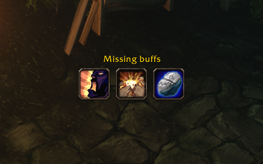

# Buff Reminder

Warns you on **World of Warcraft: Forever** when your class buffs are missing or expire, with a row of the missing ones to click and cast. Built entirely from Blizzard's own UI.

## Features

- A raid-warning message and sound when a watched buff falls off ("Arcane Intellect expired")
- A row of the missing buffs: out of combat click one to cast it (highest rank), shift-drag to move the row; in combat the buffs set to warn in combat show there too, still clickable
- Groups count as one buff: any armor, aspect, blessing or aura; Arcane Brilliance counts as Arcane Intellect, and so on
- Groups recast the one you used last (Ice Armor or Mage Armor, Aspect of the Hawk or the Monkey)
- Shaman weapon imbues and rogue poisons are checked on your weapons
- Sharpening stones, weightstones and oils too, while you carry one; clicking applies the one you used last (poisons too)
- Herbalism and mining: warns when Find Herbs / Find Minerals tracking is off
- Only buffs you know are watched; nothing warns while dead or on a flight path
- Per buff, per class: warn out of combat, in combat, always, or never (Options > AddOns > Buff Reminder)

| Class | Buffs |
| --- | --- |
| Warrior | Battle Shout (in combat) |
| Paladin | Blessing, Aura, Righteous Fury (off by default) |
| Priest | Power Word: Fortitude, Inner Fire, Divine Spirit, Shadow Protection (off), Shadowform (off) |
| Shaman | Lightning Shield, weapon imbue |
| Druid | Mark of the Wild, Thorns, Omen of Clarity |
| Rogue | Poisons (from level 20) |
| Mage | Arcane Intellect, Armor, Dampen / Amplify Magic (off) |
| Warlock | Demon Armor / Demon Skin, Soul Link |
| Hunter | Aspect, Trueshot Aura |
| Any (items) | Sharpening stone, weightstone or oil, while you carry one (out of combat) |
| Any (professions) | Find Herbs / Find Minerals, if you know either (out of combat) |

## Install

Copy the `BuffReminder` folder to `World of Warcraft/_forever_/Interface/AddOns/`.

## Usage

| Command | |
| --- | --- |
| `/brm` | Open the settings |
| `/brm preview` | Show every buff of your class in the row, to place it |
| `/brm reset` | Put the row back in its default place |
| `/brm debug` | Print what the addon sees for each buff |

## License

[GPL-3.0-or-later](LICENSE)
